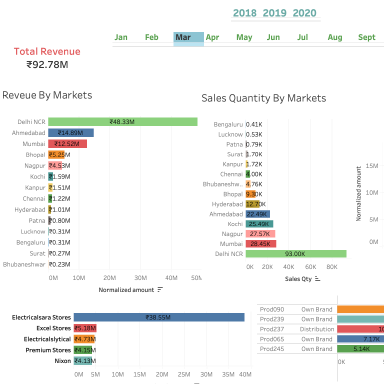

# Sales Insights Dashboard

A Tableau dashboard for exploring sales revenue, quantities, market performance, and top customers and products. Year and month filters help compare sales across periods.

The preview is extracted from the workbook's saved thumbnail. It shows a previously saved view, not live or newly verified results.

## Project files

- `Tableau sales Insights.twb`: Tableau workbook, originally saved with Tableau 2023.2.
- `docs/dashboard-preview.png`: Local dashboard preview for viewing on GitHub.

## Dashboard contents

- Total revenue and sales quantity
- Revenue by year and market
- Sales quantity by market
- Top 5 customers and products
- Year and month filters

## Open the workbook

The source dataset is **not included**. This `.twb` contains the dashboard definition and saved previews, but no packaged database or data extract. A compatible MySQL database is required to refresh and interact with the data.

1. Use Tableau Desktop with support for this workbook and the MySQL connector.
2. Obtain the original sales dataset and import it into MySQL.
3. Open `Tableau sales Insights.twb`.
4. Edit the data source connection to use your MySQL server, port, database, and credentials. The saved connection points to `127.0.0.1:3306`, database `sales`; the username is blank.
5. Refresh the data source and open the `Dashboard 2` tab.

The data model uses `transactions` with `customers`, `date`, `markets`, and `products`. Keep the original column names, including `custmer_name`, as the workbook references them.

## Calculation assumptions

The workbook converts sales amounts marked `USD` by multiplying by a fixed factor of `74`; other amounts are left unchanged. This is a saved analysis assumption, not a live exchange rate. Review it before interpreting refreshed revenue figures. Refresh automation is not configured in this repository.

## Source reference

The supplied README linked its dashboard image to [Sales_Insights](https://github.com/chitranshkumar9/Sales_Insights). That reference is retained here for provenance; this repository now displays its own saved workbook preview.
